# Tidy 사용 설명서

Tidy는 바탕 화면·다운로드 같은 폴더를 지켜보다가 새 파일을 정해 둔 규칙(또는 AI 판단)대로 정리하고, 파일 안의 글자까지 찾아 주는 프로그램입니다. **파일을 지우지 않고**, 옮긴 것은 모두 기록해 두어 언제든 되돌릴 수 있습니다.

목차

1. [설치](#1-설치)
2. [처음 실행 — 마법사](#2-처음-실행--마법사)
3. [평소 사용](#3-평소-사용)
4. [규칙 편집](#4-규칙-편집)
5. [업무 맥락 정리 (고객사·이슈별로 묶기)](#5-업무-맥락-정리-고객사이슈별로-묶기)
6. [개인정보 보관](#6-개인정보-보관)
7. [검색](#7-검색)
8. [되돌리기](#8-되돌리기)
9. [설정 화면 한눈에 보기](#9-설정-화면-한눈에-보기)
10. [도움말·정보·업데이트](#10-도움말정보업데이트)
11. [문제 해결](#11-문제-해결)
12. [NAS에서 직접 정리하기 (시놀로지·QNAP)](#12-nas에서-직접-정리하기-시놀로지qnap)

메인 창의 탭: **홈**(아직 정리 안 된 파일·오늘 한 일·고객사별 보기) · **확인 대기** · **정리하기**(정리 제안·리포트) · **되돌리기**(이동 기록) · **설정**. 오른쪽 위 **?**(도움말)에서 이 설명서·문의·업데이트 확인·정보를 엽니다. 창 폭이 900px보다 좁으면 표는 카드로, 위쪽 버튼은 **≡** 메뉴로 접힙니다(창은 960×640보다 작게 줄어들지 않습니다).

> 화면 사진은 자동 화면 테스트(e2e)가 찍은 것입니다. 실제 창과 글꼴·색이 조금 다를 수 있습니다.

---

## 1. 설치

### 설치 파일 받기

- **정식 배포판**: GitHub 저장소의 **Releases**에서 운영체제에 맞는 파일을 받습니다.
  - Windows: `.msi` 또는 `…-setup.exe`(관리자 권한 없이 내 계정에만 설치)
  - macOS: `.dmg`(Apple Silicon·Intel 공용)
  - Linux: `.deb`(Ubuntu/Debian) 또는 `.AppImage`
- **최신 개발판**: GitHub의 **Actions → Release → 최근 실행 → Artifacts**에서 OS별 묶음을 받습니다(GitHub 로그인 필요).

### Windows에서 "PC 보호" 창이 뜰 때 (SmartScreen)

아직 코드 서명을 하지 않아서 처음 실행할 때 "Windows의 PC 보호" 창이 뜰 수 있습니다. **추가 정보 → 실행**을 누르면 됩니다. macOS에서는 처음 한 번 Finder에서 앱을 **우클릭 → 열기**로 엽니다.

### 자동 시작

설치 후에는 로그인할 때 자동으로 시작해 작업 표시줄 트레이(시계 옆)에 머무릅니다. 끄려면 설정 → 고급 → "로그인 시 자동 시작"을 해제하고 저장합니다.

---

## 2. 처음 실행 — 마법사

처음 켜면 마법사가 열립니다. **마법사를 끝내기 전에는 아무 파일도 옮기지 않습니다.** 각 단계의 ⓘ를 누르면 한 줄 설명과 예시가 나옵니다.

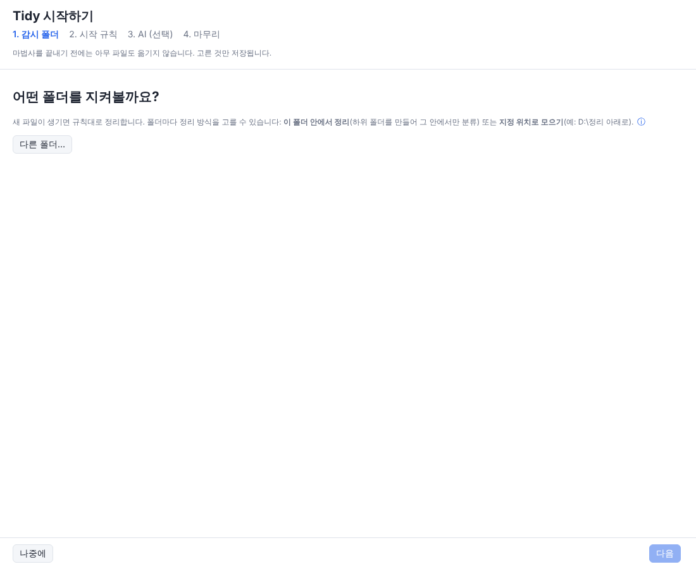

1. **감시 폴더** — 바탕 화면·다운로드 등 지켜볼 폴더를 고릅니다. 폴더마다 정리 방식을 정합니다.
   - *이 폴더 안에서 정리*: 그 폴더 안에 `문서\2026-10\` 같은 하위 폴더를 만들어 정리
   - *지정 위치로 모으기*: `D:\정리` 같은 한 곳 아래로 옮김
2. **시작 규칙** — 스크린샷·설치 파일·문서·압축·사진·영상 중 원하는 것만 체크합니다. 항목마다 "지금 N개 해당"이 보여서 결과를 미리 짐작할 수 있습니다.

   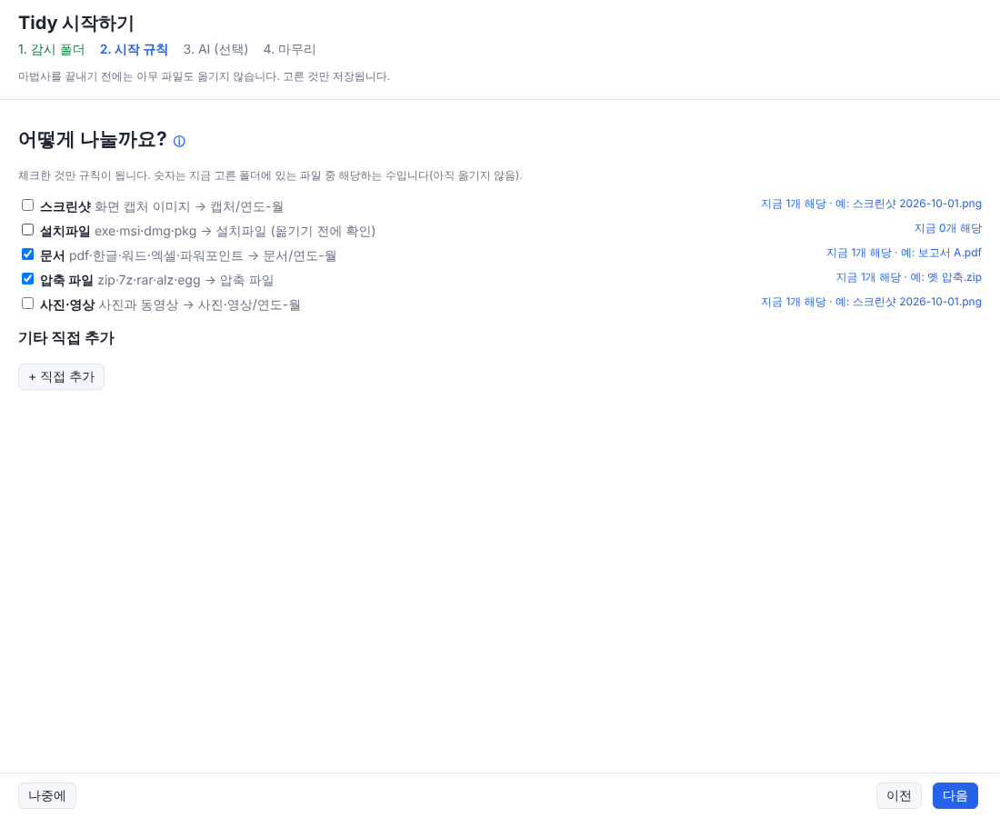

3. **AI (선택)** — AI를 켜면 규칙에 맞지 않는 파일의 자리를 AI가 제안하고, 검색창에서 자연어로 찾을 수 있습니다. 건너뛰어도 규칙과 단어 검색은 그대로 동작합니다. 고객사·이슈별로 묶는 **업무 맥락 정리**(5장)는 AI가 있어야 합니다.
4. **마무리** — 요약을 확인하고 "감시 시작". 이미 폴더에 있던 파일은 그대로 두며, 홈 탭의 **정리 현황** 카드에서 **지금 정리**로 한꺼번에 정리할 수 있습니다(3장).

마법사는 설정 → 고급 → "마법사 다시 실행"으로 언제든 다시 열 수 있습니다.

---

## 3. 평소 사용

### 상태줄 읽는 법

탭 아래 한 줄이 지금 상태를 요약합니다.

```
● 새 파일 자동 정리 중 │ 감시 4곳 → 정리 위치 D:\정리          인덱스 50,357 │ AI 사용 · claude-haiku-5-5
```

- **왼쪽**: 지금 상태("새 파일 자동 정리 중" / "일시정지" / "연결 끊김 N곳"(NAS)).
- **가운데**: 감시하는 폴더 수와 정리 결과가 가는 곳(모든 폴더가 "이 폴더 안에서"면 "각 폴더 안에서 정리", 여러 곳이면 "정리 위치 N곳"). 마우스를 올리면 전체 경로가 보이고, **누르면 감시 현황 패널**이 열립니다.
- **오른쪽**: 검색 인덱스의 파일 수, AI 상태와 모델. 새 버전이 있으면 "● 새 버전 0.x.y"(10장).
- 설정 탭에서는 상태줄이 숨겨집니다(한 화면에 한 작업).

**긴 경로는 가운데를 줄여** `C:\Users\…\Desktop`처럼 보입니다. 마우스를 올리면 전체 경로가, 누르면 탐색기에서 그 폴더가 열립니다. 감시 폴더는 경로 대신 **별칭**(바탕화면·다운로드·문서·사진은 자동, 나머지는 마지막 폴더 이름)으로 부르며, 설정 → 감시 폴더 → 편집에서 바꿀 수 있습니다.

**감시 현황 패널**(상태줄을 누르면 홈 맨 위에 열림)은 폴더마다 한 줄입니다: 별칭·경로 | 정리 위치(이 폴더 안 / → D:\정리) | 상태(정상·연결 끊김·일시정지) | 제외 폴더 수 | 기존 파일 미정리 수.

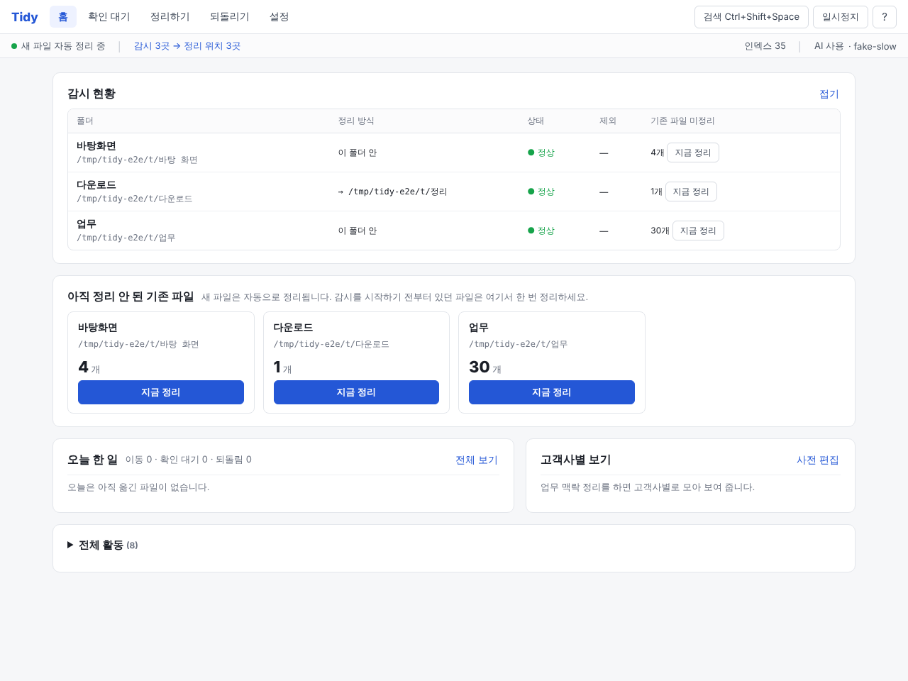

### 기존 파일 정리하기 — 홈의 "아직 정리 안 된 기존 파일"

**새 파일은 자동으로 정리됩니다.** 감시를 시작하기 전부터 폴더에 있던 파일은 그대로 두는데, 홈 탭 맨 위 **아직 정리 안 된 기존 파일** 카드가 폴더마다(한 줄에 4개) 별칭·경로·개수를 보여 줍니다(숫자에 마우스를 올리면 "규칙에 맞음 N · 규칙 없음 M"). 폴더가 아주 크면 20,000개까지만 세고 "20,000+"로 보이며, NAS 폴더는 세지 않습니다. 그 아래 **오늘 한 일**(오늘 옮긴 파일·폴더, 확인 대기·되돌림 수)과 **고객사별 보기**가 나란히 있고, 전체 활동 목록은 맨 아래에 접혀 있습니다("전체 보기"로 펼침).

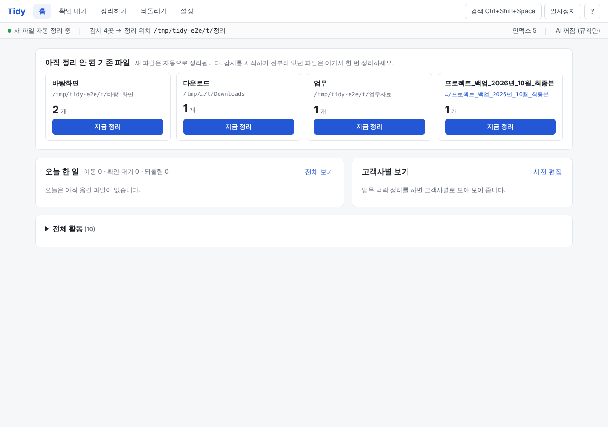

1. 폴더 옆 **지금 정리**를 누르면 **정리하기** 탭으로 가서 그 폴더의 "규칙으로 정리 미리보기"가 바로 만들어집니다.
2. 미리보기 위에 **"적용을 누르기 전에는 아무것도 옮기지 않습니다. 적용 후에도 되돌리기 탭에서 되돌릴 수 있습니다."** 가 보입니다. 옮길 항목만 체크하고 **선택한 N개 적용**.
3. 규칙에 안 맞는 파일은 AI가 켜져 있고 맥락 사전이 있으면 **업무 맥락으로 정리** 버튼이 강조되어 나란히 나옵니다(5장, 비용 안내 후 분석).

감시 폴더 바로 아래에 **하위 폴더**(예: `가온누리원 로그`)가 있으면 카드 숫자 옆에 **새 폴더 N**이 함께 나옵니다. 누르면 정리하기 탭에서 바로 업무 맥락 정리를 시작합니다 — 폴더는 쪼개지 않고 **통째로 한 항목**으로 옮깁니다(5.1). 복사 중이거나 방금 바뀐 폴더는 "(복사 중 N개)"로만 보이고, 1분 동안 조용해진 뒤 셉니다.

> 정리하기 탭의 폴더 목록에는 감시 폴더만 나옵니다. 다른 폴더는 **다른 폴더…**로 고르세요. 고른 폴더가 "지정 위치로 모으기"의 정리 위치(예: `D:\정리`)이거나 그 아래면 "이 폴더는 정리 결과가 모이는 곳입니다"라는 경고가 나오고, 미리보기 전에 두 번 확인합니다 — 이미 정리된 파일을 다시 옮기게 되기 때문입니다.

### 새 파일과 확인 팝업

- **새 파일이 생기면** 규칙에 맞는 것은 바로 정리됩니다. 홈 탭 아래쪽 활동 목록에 "무엇을 어디로 옮겼는지"가 쌓입니다.
- 바탕화면의 **바로가기**(.lnk, .url 등)는 정리하지 않고 제자리에 둡니다(기본). 바로가기도 옮기고 싶으면 설정 → 고급 → "바로가기는 그대로 두기"를 끕니다.
- 감시 폴더 안에서도 **건드리지 말아야 할 하위 폴더**(진행 중인 작업 폴더 등)는 설정 → 감시 폴더 → 그 폴더 **편집** → **건드리지 않을 하위 폴더 (제외)** 의 **+ 추가**로 넣습니다. 여러 개 가능하고, 그 안의 파일은 정리·미리보기·맥락 정리에서 빠집니다(검색은 됩니다).
- **확인이 필요한 파일**(규칙의 "옮기기 전 확인", AI 제안, 새 고객사·이슈, 개인정보)은 화면 오른쪽 아래에 **확인 팝업**이 뜹니다.

  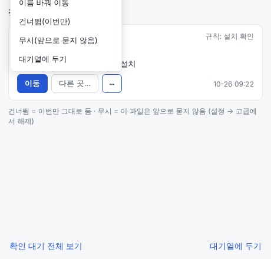

  - 팝업과 **확인 대기** 탭은 같은 카드입니다. 버튼은 **이동**(제안 위치로)과 **다른 곳…** 둘이고, 나머지는 **⋯** 메뉴에 있습니다: 다른 곳으로… · 이름 바꿔 이동 · 건너뜀(이번만) · 무시(앞으로 묻지 않음) · 대기열에 두기.
  - AI 제안에는 확신도가 붙습니다: 80% 이상은 파란색, 그보다 낮으면 주황색 "확신 낮음".
  - **건너뜀(이번만)**: 이번만 그대로 둡니다. 파일이 다시 바뀌거나 "지금 정리"를 하면 또 묻습니다.
  - **무시(앞으로 묻지 않음)**: 이 파일은 앞으로 묻지도 옮기지도 않습니다. 풀려면 설정 → 고급 → **무시한 파일**에서 "해제".
  - 파일이 다른 프로그램(Word 등)에서 열려 있으면 옮길 수 없다는 이유가 팝업에 남습니다. 닫은 뒤 다시 "이동"을 누르세요.
  - **대기열에 두기**: 결정을 미룹니다. 팝업을 닫고 **확인 대기** 탭에 남겨 둡니다.
- 팝업이 귀찮으면 설정 → 고급 → "조용 모드"를 켭니다. 팝업 없이 확인 대기 탭에만 쌓입니다.
- **확인 대기** 탭은 넓은 창에서 표(파일 · 제안 위치 · 제안·확신도 · 동작)로, 좁은 창에서 카드로 보입니다. 맨 위 **모두** 체크 후 **선택한 항목 제안 위치로 이동**으로 한꺼번에 처리합니다.

  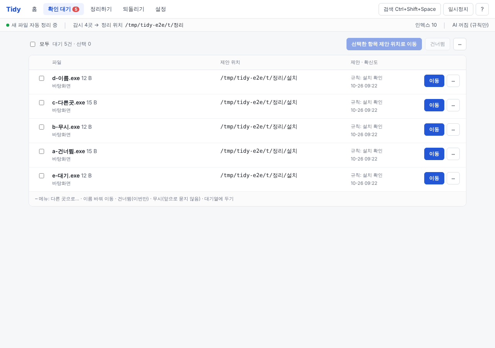
- 같은 결정을 여러 번 하면 확인 대기 탭 위에 "이런 규칙을 만들까요?" 카드가 나옵니다(학습 제안).

### 똑같은 파일이 두 개 이상 있으면

"똑같은 파일" = 이름은 상관없이 **내용이 한 글자도 다르지 않은** 파일입니다. Tidy는 두 경우를 나눠 다룹니다.

**① 옮길 자리에 이름과 내용이 같은 파일이 이미 있을 때** — 설정 → 감시 폴더 → **옮길 자리에 똑같은 파일이 이미 있으면**에서 고릅니다.

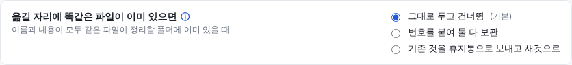

- **그대로 두고 건너뜀**(기본): 새로 온 파일을 원래 자리에 둡니다. 활동 목록에 "똑같은 파일이 이미 D:\정리\문서\에 있어 그대로 둠"과 **기존 파일 열기**가 나옵니다.
- **번호를 붙여 둘 다 보관**: `보고서 (1).pdf`처럼 번호를 붙여 옮깁니다.
- **기존 것을 휴지통으로 보내고 새것으로**: 이미 있던 사본을 **휴지통**으로 보내고(지우지 않음) 새 파일을 그 자리에 둡니다.
- 이름만 같고 **내용이 다르면** 어느 설정이든 언제나 번호를 붙입니다. 덮어쓰는 일은 없습니다.
- 확인이 필요한 파일이면 팝업·확인 대기에 미리 **"똑같은 파일이 이미 있습니다"**가 뜨고, 그 항목에만 **[그대로 두기] [번호 붙여 이동] [기존 것 휴지통 후 이동]** 세 버튼이 나옵니다(이번 한 번만 적용, 설정은 그대로).

  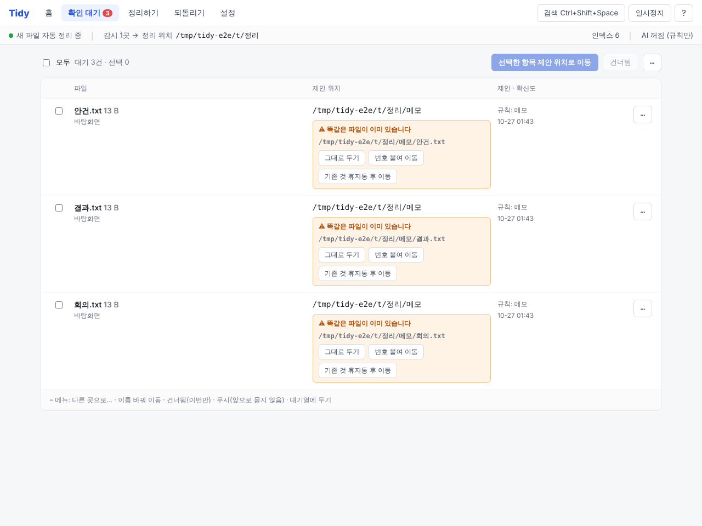

**② 이름은 달라도 내용이 같은 파일이 여러 개일 때** — **정리하기** → 폴더 리포트 → **리포트 만들기** → **중복 파일 (N그룹)**.

- 그룹마다 사본 목록이 나오고, 동그라미(라디오)로 **남길 파일**을 고릅니다. 기본으로는 *정리 위치 안에 있는 것 → 가장 오래된 것 → 경로가 짧은 것*이 골라져 있습니다. 감시 폴더가 정리 위치로 모으는 방식이면 **정리 위치에 이미 있는 사본**도 같은 그룹에 나옵니다("정리 위치" 표시).
- **이 그룹 정리**를 체크하거나, 맨 위 **모든 그룹에 기본 선택 적용**을 켭니다 → **미리보기**: 남길 파일 / 휴지통으로 보낼 파일, "휴지통으로 N개 · 용량 절약 X" → **적용**. 적용을 누르기 전에는 아무것도 옮기지 않습니다.
- 나머지 사본은 **휴지통**으로만 갑니다. 보내기 직전에 내용을 다시 비교해서, 그사이 바뀐 파일이나 남길 파일이 없어진 그룹은 건드리지 않습니다.

  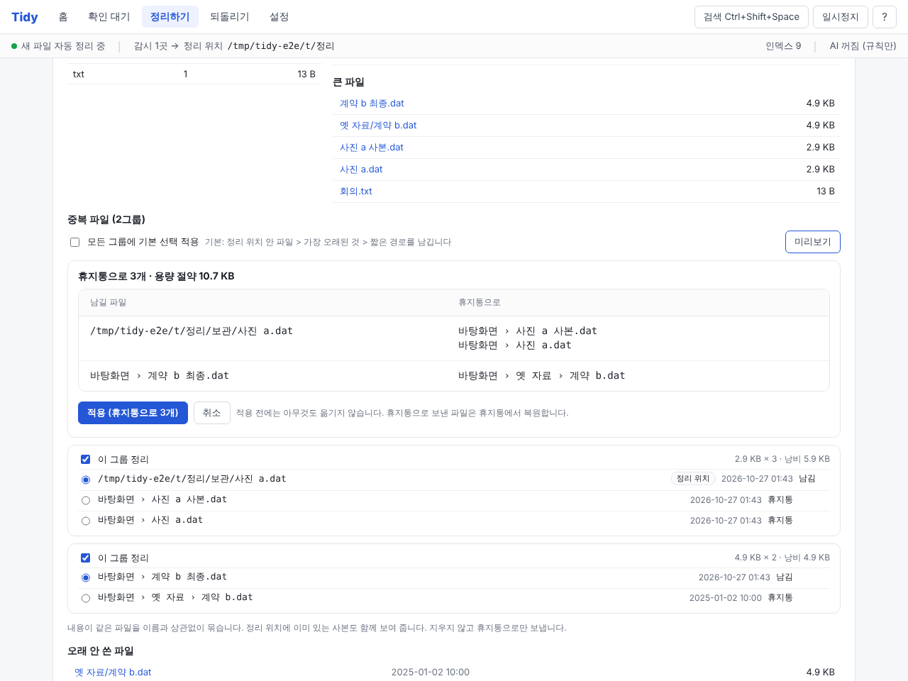

휴지통으로 보낸 기록은 **되돌리기** 탭에 "중복 정리(휴지통)" 묶음으로 남습니다. Windows·macOS 휴지통은 프로그램이 꺼내 올 수 없어서, 되돌리기를 누르면 "휴지통에서 복원하세요"와 **휴지통 열기**가 나옵니다(8장). 명령줄: `tidy dedupe [폴더]`(목록만) → `tidy dedupe [폴더] --apply [--only 1,3]`.

---

## 4. 규칙 편집

설정 → 규칙에서 편집합니다. 규칙은 한 줄씩 접혀 있고(이름 · 조건 요약 · 목적지 · 지금 N개), **펼치기**를 누른 하나만 열립니다. 저장하기 전에는 아무것도 바뀌지 않습니다.

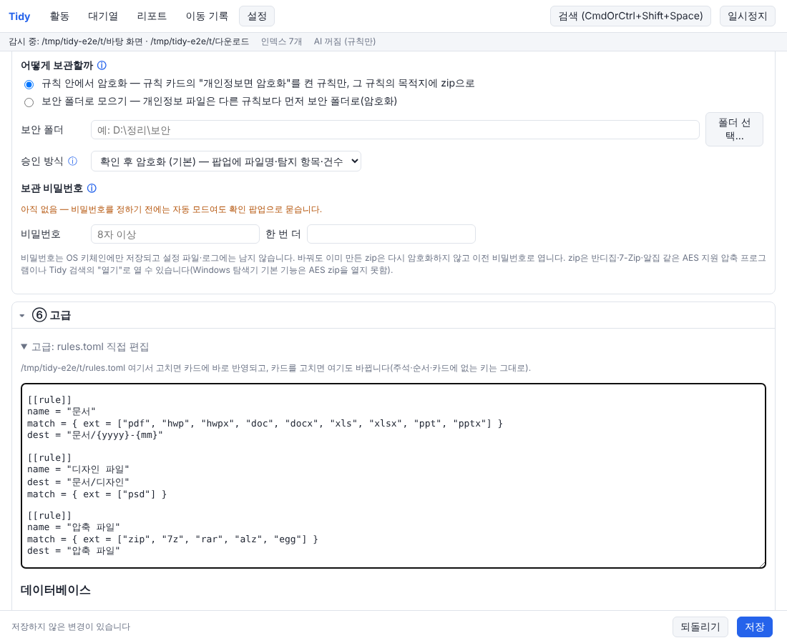

- **조건**: 확장자 칩(`pdf`, `hwp`…), 이름에 포함되는 글자. 정규식·크기·날짜·사용 안 함·순서 버튼은 **조건 더 보기**에 있습니다.
- **목적지**: 폴더 트리에서 고르거나 직접 입력. `{yyyy}`(연도), `{mm}`(월) 같은 변수 칩을 눌러 넣을 수 있습니다. 상대 경로(`문서/{yyyy}-{mm}`)면 감시 폴더의 정리 방식을 따릅니다.
- **"정리 위치 무시" 경고**: 감시 폴더를 "지정 위치로 모으기"로 해 두었는데 규칙 목적지가 `C:\…`, `D:\…`, `~/…` 같은 절대 경로면, 그 규칙은 기준 폴더를 무시하고 그 경로로 보냅니다. 접힌 줄에 주황색 **⚠ 경로**와 **상대 경로로** 버튼이, 펼친 카드에는 "이 규칙은 정리 위치(D:\정리)를 무시하고 … 로 보냅니다"가 뜨고, 어느 쪽이든 누르면 마지막 한두 단계(`문서/{yyyy}-{mm}`)로 바뀝니다. 저장할 때도 저장줄에 "규칙 N개가 정리 위치를 무시합니다"가 보입니다.

  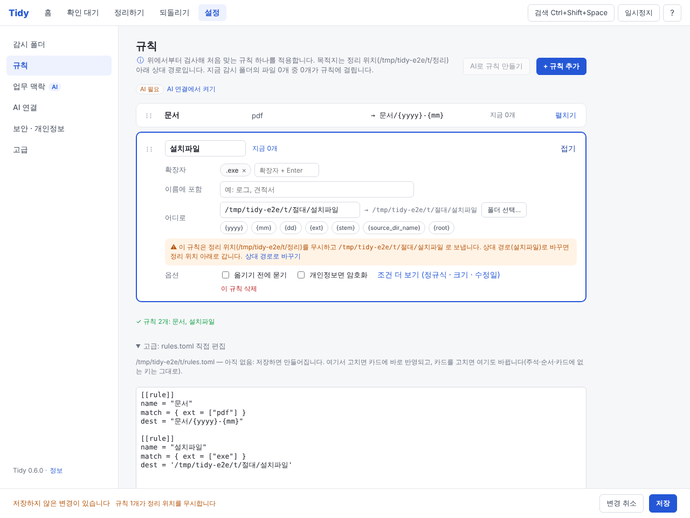
- **옵션**: 옮기기 전 확인, AI 자동 이동 허용, 🔒 개인정보면 암호화
- **순서**: 위에서부터 검사해 **처음 맞는 규칙 하나만** 적용합니다. 카드를 끌어 순서를 바꿉니다(ⓘ 규칙 순서). 예: "스크린샷"을 "이미지"보다 위에 두어야 스크린샷이 따로 모입니다.
- 카드마다 "지금 N개"가 보입니다 — 지금 감시 폴더에 그 규칙에 걸리는 파일 수입니다.
- **AI로 규칙 만들기**: 감시 폴더의 파일 목록(이름·크기·날짜)을 보내 규칙 초안을 받습니다. 받은 카드는 "AI 제안" 표시가 붙고, 저장해야 반영됩니다.
- 고급 사용자는 규칙 페이지 맨 아래 **고급: rules.toml 직접 편집**에서 글로 고칠 수 있습니다. 카드와 서로 바로 맞춰지고, 주석은 그대로 남습니다.

---

## 5. 업무 맥락 정리 (고객사·이슈별로 묶기)

확장자가 아니라 **"어느 고객사의 어느 이슈 때 생긴 자료인지"** 로 묶습니다.

```
가람정보\20261014_과금이슈\로그\GARA_과금_20261014_로그.log
가람정보\20261014_과금이슈\안내문서\가람정보_과금이슈_20261020_안내문.txt
가온누리원\20261020_로그분석\개발\가온누리원 로그\tools\go\…   ← 폴더는 통째로, 안의 구조 그대로
기타\정책\문자 발송 정책\…            ← 고객사가 없는 문서는 주제로
```

> **AI가 필요합니다.** AI가 꺼져 있으면 관련 버튼이 모두 흐리게 바뀌고 "AI 필요" 배지와 **AI 연결에서 켜기** 링크가 보입니다. 링크를 누르면 설정 → AI 연결로 갑니다.
>
> 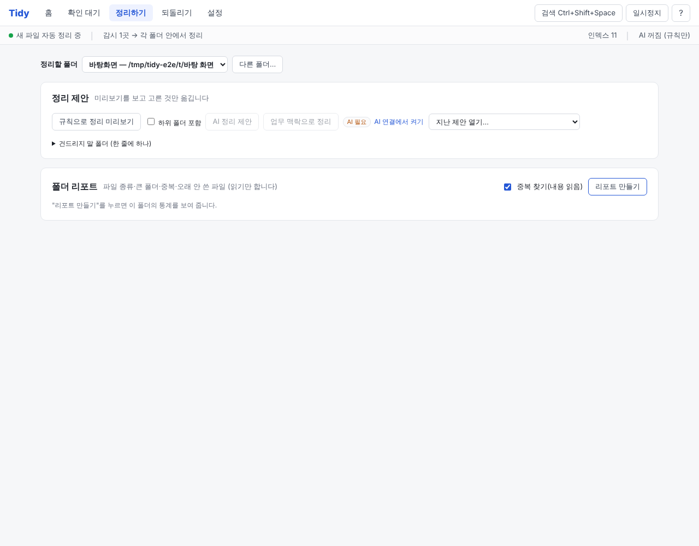

### 5.1 폴더는 통째로, 파일은 하나씩

정리하는 폴더(예: 바탕화면) 안을 이렇게 나눠서 봅니다.

- **바로 아래 하위 폴더 = 한 항목.** `가온누리원 로그` 폴더 안에 `tools\go\*.go` 30개가 있어도, AI에는 폴더 하나의 **요약**(이름, 경로, 파일 수, 많은 확장자, 대표 파일 이름 10개, 가장 큰·최근 파일, 안의 폴더 이름, README 앞부분)만 보내고, 옮길 때도 폴더째 옮깁니다. 안의 파일이 고객사·종류별로 흩어지지 않습니다.
- **바로 아래 파일 = 파일 하나씩** 판단합니다(전과 같음).
- **경로도 단서입니다.** AI는 파일 이름과 함께 "어느 폴더에 있었는지"(`폴더: 가온누리원 로그/tools/go`)를 받습니다. 특히 맨 위 폴더 이름은 고객사를 가리키는 가장 강한 단서로 봅니다.
- 이미 정리된 폴더(Tidy가 옮겨 넣은 폴더, 규칙 목적지, 정리 위치), 숨김·제외 폴더는 항목에서 빠집니다.
- **복사 중이거나 방금 바뀐 폴더**(안의 무엇이든 1분 안에 바뀜)는 이번에 빼고, 비용 안내에 "복사 중이거나 방금 바뀐 폴더 N개는 이번에 빼고"라고 알려 줍니다. 기다리는 시간은 `config.toml`의 `[curate] folder_settle_secs`(기본 60초).
- 폴더 항목의 날짜는 **안에서 가장 최근 파일의 날짜**입니다. 미리보기에서 고칠 수 있습니다.

> 규칙 정리의 "하위 폴더 포함"은 업무 맥락 정리에는 쓰이지 않습니다. 업무 맥락 정리는 언제나 하위 폴더를 통째로 봅니다.

### 5.2 맥락 사전 만들기

설정 → 업무 맥락의 **맥락 사전**에 고객사 이름과 별칭(영문·약칭), 이슈 유형, 자료 종류를 적어 둡니다. AI가 같은 이름으로 묶는 데 씁니다.

처음에는 **바탕화면에서 뽑기**를 누르세요. 감시 폴더 **바로 아래 폴더 이름**(가장 먼저 고객사 후보로 봅니다)과 파일 이름(과 본문 앞부분)을 AI에 보내 고객사·이슈 후보를 뽑아 줍니다. 예를 들어 바탕화면에 `가온누리원 로그` 폴더가 있으면 `가온누리원`가 후보로 나옵니다. 넣을 것만 체크하고 이름을 고친 뒤 **고른 것 사전에 넣기 → 저장**.

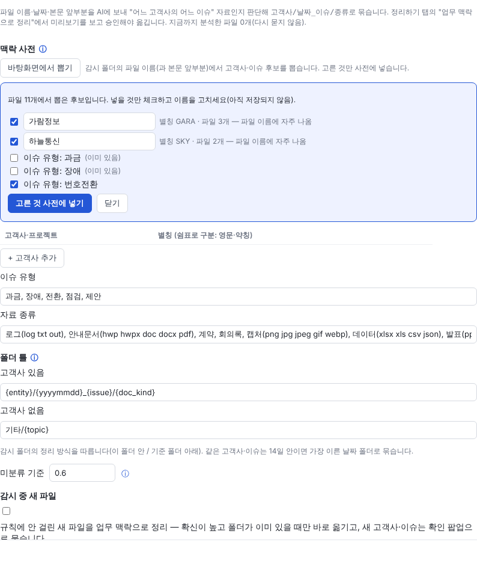

예: 고객사 `가람정보`, 별칭 `GARA, 가람` → `GARA_장애로그.log`도 가람정보로 묶입니다.

### 5.3 미리보기 보고 정리하기

1. **정리하기** 탭에서 폴더를 고르고 **업무 맥락으로 정리**를 누릅니다(홈의 **새 폴더 N개 — 지금 정리**도 같은 일을 합니다). 항목이 많으면 AI 답이 오는 데 시간이 걸립니다(30개에 30초 안팎).
2. 먼저 **비용 안내**가 뜹니다 — 분석할 항목 수("항목 4개(폴더 1개는 통째로, 파일 3개)"), 예상 토큰, (요금을 아는 모델이면) 예상 금액. 이미 분석한 파일·폴더는 다시 묻지 않으므로 두 번째부터는 거의 비용이 들지 않습니다(폴더는 안의 파일이 하나라도 바뀌면 다시 묻습니다).
3. 미리보기에 항목마다 **AI 판단**(고객사·이슈·날짜·종류, 확신도, 근거)과 "적용 후" 폴더 모양이 나옵니다.

   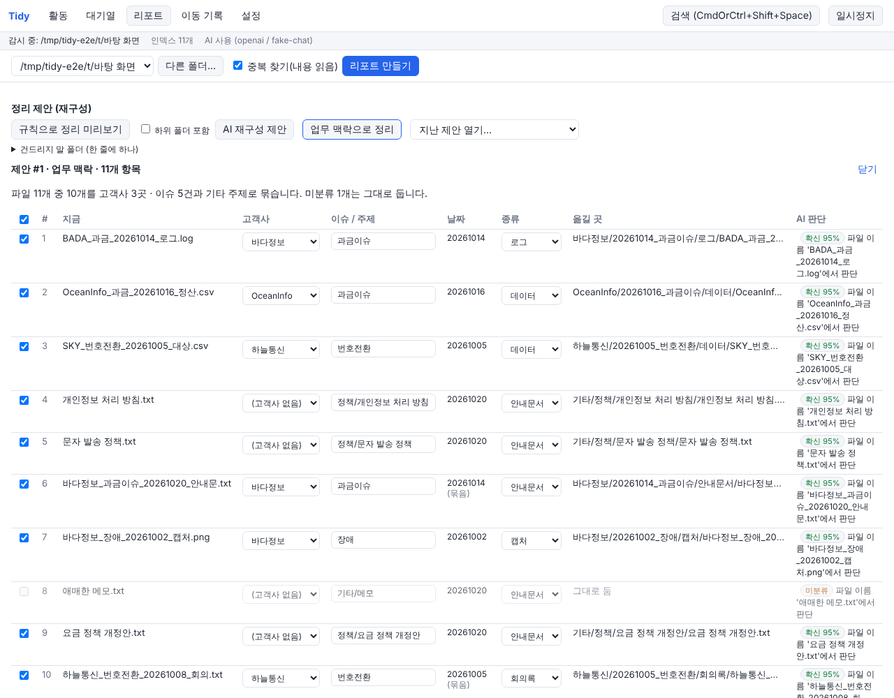

   - **폴더 항목**은 📁 표시와 "파일 N개 · 크기"로 보입니다. ▸를 누르면 안의 폴더 구조가 펼쳐집니다. 옮길 곳은 `고객사\날짜_이슈\종류\폴더 이름`이고, 안의 구조는 그대로 갑니다.
     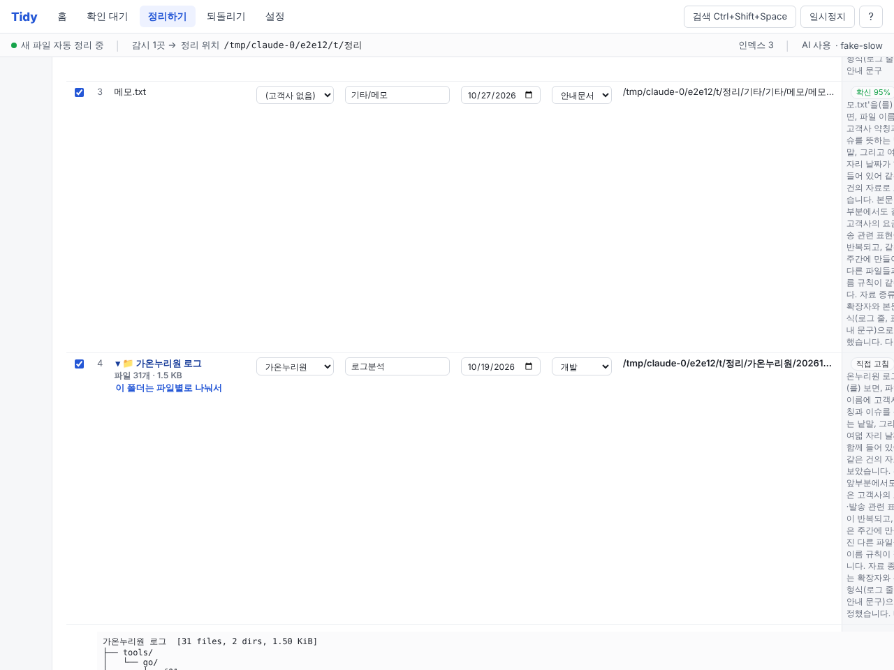

   - 폴더 안 파일을 따로따로 정리하고 싶으면 **이 폴더는 파일별로 나눠서**를 누릅니다. 그 폴더의 파일들을 하나씩 다시 분석(AI 요청)해 각각 한 줄로 바꿔 줍니다.
   - 같은 고객사·이슈는 날짜가 **14일 안**이면 가장 이른 날짜 폴더 하나로 묶습니다(예: 10월 14일·20일 자료 → `20261014_과금이슈`).
   - 확신도가 기준(기본 60%)보다 낮은 항목은 **미분류**로 그대로 둡니다.
4. 틀린 항목은 **고객사 드롭다운·이슈 칸·날짜·종류**를 바로 고칩니다. 옮길 곳이 다시 계산되고, 고친 내용을 사전에 넣을지 묻는 상자가 나옵니다(예: "'가람정보'의 별칭으로 'RiverInfo' 추가" → **사전에 반영**). 다음 분석부터 같은 실수를 하지 않습니다.
5. 옮길 항목만 체크하고 **선택한 N개 적용**. 확인을 누르기 전에는 아무것도 옮기지 않습니다.
6. 적용한 것은 폴더째 옮긴 파일까지 모두 한 묶음(배치)으로 기록되어 **이 정리 되돌리기** 또는 **되돌리기** 탭에서 한 번에 되돌릴 수 있습니다. 폴더를 통째로 옮겨 비게 된 원래 폴더는 정리하고, 되돌리면 원래 자리에 다시 만들어집니다(원래부터 비어 있던 하위 폴더는 되살리지 않습니다).

개인정보 파일은 보안 설정(6장)이 "보안 폴더로 모으기"이면 같은 맥락 폴더에 암호화 zip으로 들어갑니다.

### 5.4 감시 중 새 파일도 맥락으로

설정 → 업무 맥락 → "규칙에 안 걸린 새 파일을 업무 맥락으로 정리"를 켭니다.

- 대상은 **감시 폴더 바로 아래의 새 파일**뿐입니다. 하위 폴더 안에서 생기거나 바뀐 파일은 맥락 정리로 흩어 놓지 않습니다(규칙 정리는 전과 같이 감시 설정의 "하위 폴더"를 따릅니다).
- 이미 있는 고객사·이슈 폴더이고 AI가 충분히 확신하면(설정 → AI 연결의 "자동 이동 기준", 기본 90%) **바로 그 폴더로** 옮깁니다.
- 새 고객사나 새 이슈면 확인 팝업으로 묻습니다.

  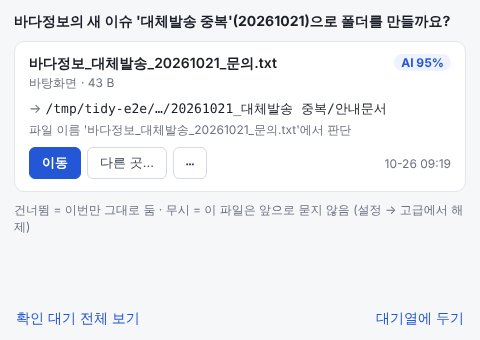

- **새 폴더**는 감시 중에 자동으로 옮기지 않고, 폴더마다 팝업을 띄우지도 않습니다. 홈의 "새 폴더 N개 — 지금 정리"로 미리보기를 보고 승인해야 옮깁니다.
- "맥락 정리 우선"을 켜면 규칙보다 먼저 맥락으로 정리합니다.

### 5.5 폴더 모양 바꾸기 (폴더 틀)

설정 → 업무 맥락 → 폴더 틀(ⓘ)에서 바꿉니다.

| 칸 | 기본값 | 결과 예 |
|---|---|---|
| 고객사 있음 | `{entity}/{yyyymmdd}_{issue}/{doc_kind}` | `가람정보\20261020_과금이슈\로그\` |
| 고객사 없음 | `기타/{topic}` | `기타\정책\문자 정책\` |

변수: `{entity}` 고객사, `{issue}` 이슈, `{doc_kind}` 자료 종류, `{topic}` 주제(2단까지), `{yyyy}` `{mm}` `{dd}` `{yyyymmdd}` 날짜, `{folder}` 폴더 항목의 이름(파일이면 빈 칸). 폴더 항목은 틀에 `{folder}`가 없으면 틀 끝에 폴더 이름을 붙입니다. 감시 폴더의 정리 방식(이 폴더 안 / 지정 위치로 모으기)을 기준으로 풉니다.

### 고객사 자료는 어디 있나요?

- **홈 → 고객사별 보기**: 고객사마다 이슈 폴더 수, 파일 수, 마지막 작업 날짜가 나옵니다. 이름을 누르면 탐색기에서 그 고객사 폴더가 열립니다(감시 폴더가 여럿이라 고객사 폴더가 여러 곳이면 첫 곳을 열고, 나머지는 이름에 마우스를 올리면 보입니다).

  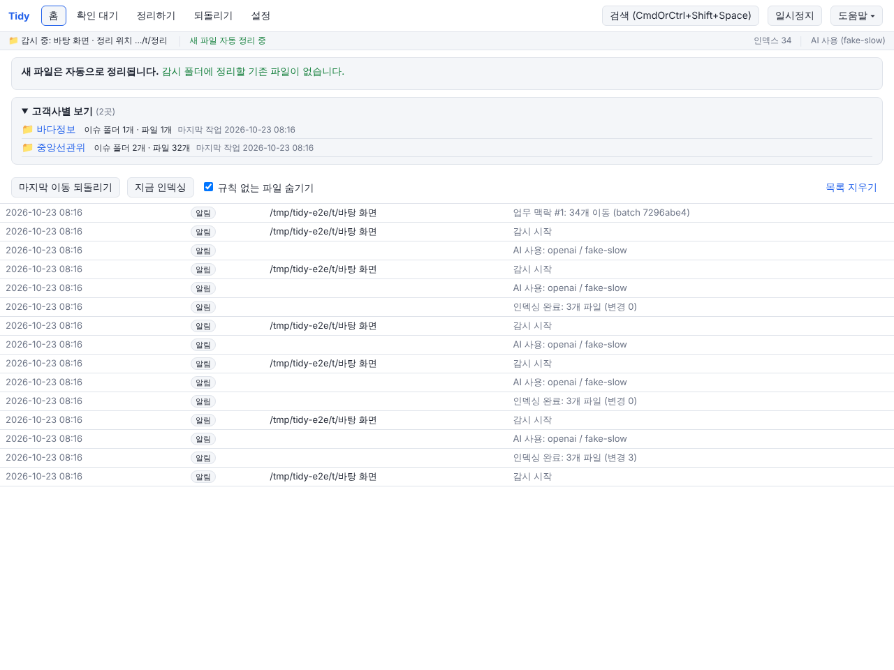
- **검색창 → 고객사 필터**: 검색창 오른쪽 드롭다운에서 고객사를 고르면 그 고객사 폴더 안에서만 찾습니다("모든 고객사"가 기본).
- 고객사 폴더는 감시 폴더의 정리 기준 폴더 바로 아래에 있습니다 — "이 폴더 안"이면 감시 폴더 안(예: `바탕 화면\가온누리원`), "지정 위치로 모으기"면 정리 위치 안(예: `D:\정리\가온누리원`).
- 도움말 메뉴 → **고객사 자료는 어디 있나요?** 가 이 절을 엽니다.

---

## 6. 개인정보 보관

인터넷 없이 파일 안의 글자(한글 hwp·hwpx 포함)와 이름에서 **주민등록번호, 계좌번호, 이름+휴대전화, 이름+이메일**을 찾아 암호화 zip(AES-256)으로 보관합니다. 설정 → 보안 · 개인정보.

1. **비밀번호를 정합니다**(8자 이상, 두 번 입력 → 저장). 비밀번호는 Windows 자격 증명 관리자 같은 OS 보안 저장소(키체인)에만 저장되고, 설정 파일·로그에는 남지 않습니다.
2. **보관 방식**(ⓘ)을 고릅니다.
   - *규칙 안에서 암호화*: 규칙 카드에서 "🔒 개인정보면 암호화"를 켠 규칙만, 그 규칙의 목적지에 zip으로
   - *보안 폴더로 모으기*: 개인정보 파일은 다른 규칙보다 먼저 보안 폴더(예: `D:\정리\보안`)로
3. **승인 방식**: 기본은 *확인 후 암호화* — 팝업에 "개인정보: 이름+휴대전화 15"처럼 무엇이 몇 건인지 보이고, 승인해야 진행합니다.

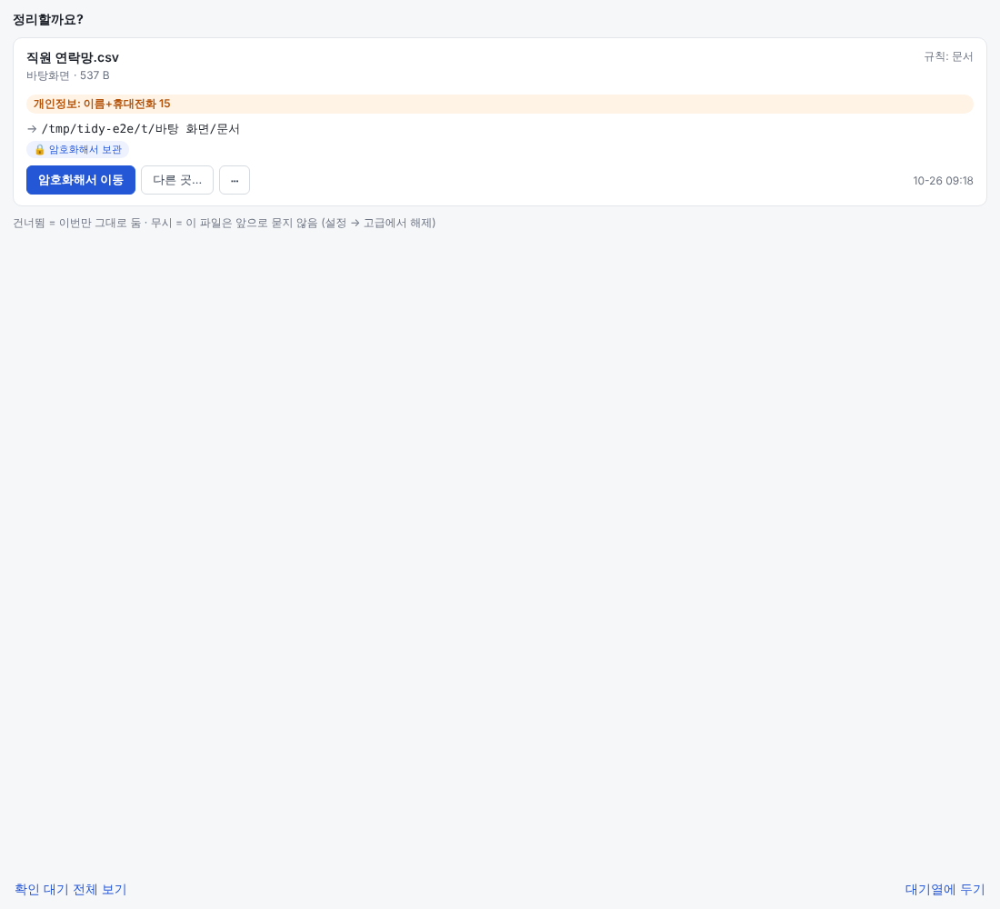

- 만든 zip은 반디집·7-Zip·알집으로 열 수 있습니다(**Windows 탐색기 기본 기능으로는 열리지 않습니다**). Tidy 검색에서 🔒 파일을 열면 잠깐 풀어 보여 주고 10분 뒤 임시 사본을 지웁니다.
- 원본은 zip을 다시 열어 내용이 같은지 확인한 **다음에만** 정리합니다. 되돌리기로 원래 자리·이름으로 풀립니다.
- 비밀번호를 바꿔도 예전 zip은 예전 비밀번호로 계속 열립니다(이전 비밀번호를 함께 보관).

---

## 7. 검색

어디서든 **Ctrl+Shift+Space**(설정 → 고급에서 변경)로 검색창을 엽니다. 파일 이름과 **파일 안의 글자**(한글 hwp·hwpx, pdf, docx, xlsx, pptx, txt 등 대부분의 문서, 표 안의 글자, 캡처·스캔본 속 글자 포함)에서 찾습니다. 암호를 건 한글 문서·배포용 문서는 본문을 읽을 수 없어 이름·날짜로만 찾습니다.

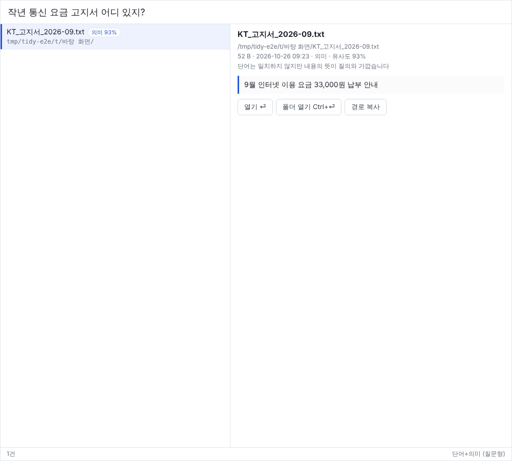

- 필터: `ext:pdf,docx` `in:"바탕 화면"` `after:2026-09` `before:2026-10` `size:>10mb` `type:image`, 정확한 구절은 `"따옴표"`
- 의미검색 모델(설정 → AI 연결, ⓘ)이 있으면 "작년에 받은 통신 요금 고지서"처럼 **말로** 찾아도 됩니다. 없으면 단어 검색만 합니다.
- ↑↓로 고르고 Enter로 열기, Ctrl+Enter로 폴더 열기.
- 🔒 표시는 암호화 보관된 파일입니다.
- **사진 속 글자** 표시는 캡처·사진·스캔한 PDF 안의 글자를 읽어서 찾은 파일입니다(아래).
- **사진 설명** 표시는 AI가 사진을 보고 붙인 설명으로 찾은 파일입니다(아래 "사진 내용으로 찾기·정리").

### 사진·스캔 PDF 속 글자

화면 캡처, 휴대폰으로 찍은 문서 사진(png·jpg·bmp·gif·tif·webp), 스캐너로 만든 PDF처럼 **글자가 그림으로만 들어 있는 파일**도 그 안의 글자로 찾을 수 있습니다. 예: 견적서 캡처를 "가람정보"로 검색.

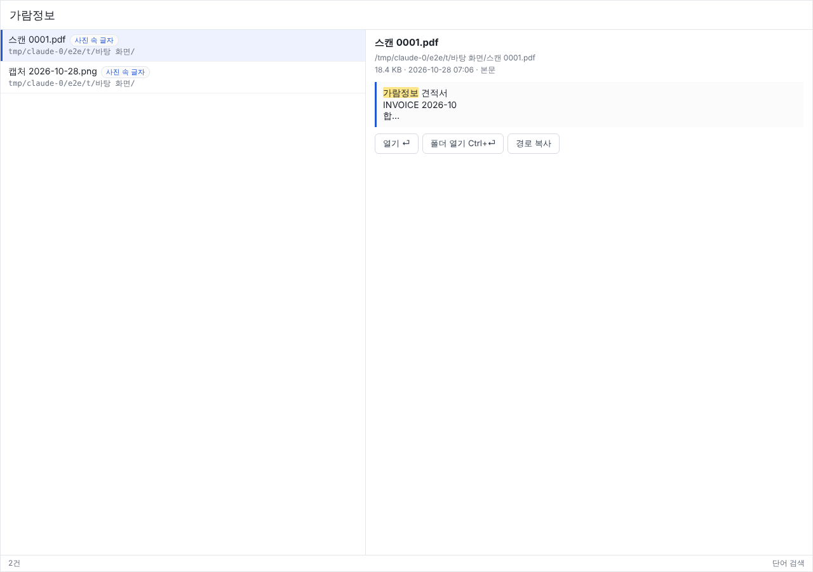

- 따로 할 일은 없습니다. 인덱싱이 끝나면 뒤에서 조금씩 읽어 둡니다(파일 하나에 1초 안팎). 이미 있던 사진도 설치 후 자동으로 따라잡습니다. 같은 파일을 옮기거나 복사해도 다시 읽지 않습니다.
- **Windows에 들어 있는 글자 인식(OCR)**을 쓰므로 설치할 것이 없고, 인터넷도 쓰지 않으며 파일이 밖으로 나가지 않습니다. 한국어 Windows면 한국어를 읽습니다. 설정 → 고급 카드에 "한국어 인식 언어팩 없음"이 보이면 Windows 설정 → 시간 및 언어 → 언어 → 한국어 → 언어 옵션 → **광학 문자 인식**을 설치하세요.
- 진행 상황과 켜기/끄기는 **설정 → 고급 → 사진·스캔 PDF 속 글자 검색** 카드에 있습니다(스위치는 바로 저장). 읽지 못한 파일이 있으면 **실패한 N개 다시 시도**.

  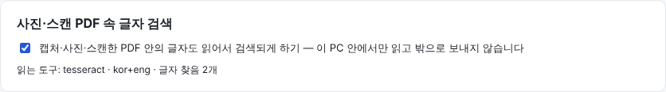
- 아이콘처럼 아주 작은 그림(4KB 미만)과 20MB 넘는 그림은 읽지 않고, 스캔 PDF는 앞 10쪽까지 읽습니다.
- 사진에서 읽은 글자에 주민등록번호 같은 개인정보가 있으면 6장의 개인정보 탐지에도 걸립니다.
- macOS·Linux는 tesseract가 설치되어 있으면 그것을 씁니다(`brew install tesseract tesseract-lang poppler` / `apt install tesseract-ocr tesseract-ocr-kor poppler-utils`).
### 사진 내용으로 찾기·정리 (AI, 선택)

글자가 없는 사진도 **찍힌 내용**으로 찾고 정리할 수 있습니다. AI가 사진을 보고 "카페에서 받은 종이 영수증 (태그: 영수증, 카페, 경비)"처럼 짧은 설명을 붙여 두기 때문에, "영수증"·"화이트보드"·"명함"으로 검색하면 `IMG_2041.jpg` 같은 이름의 사진도 나옵니다. 새 사진이 들어오면 AI가 이 설명을 보고 정리할 폴더를 고릅니다.

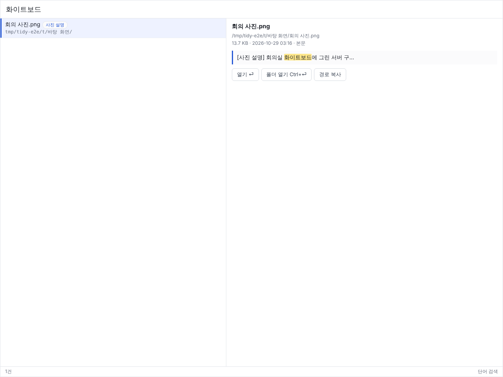

- **설정 → AI 연결 → 사진 내용 인식** 카드에서 켭니다(기본은 꺼짐, 스위치는 바로 저장). AI 연결이 먼저 되어 있어야 합니다.

  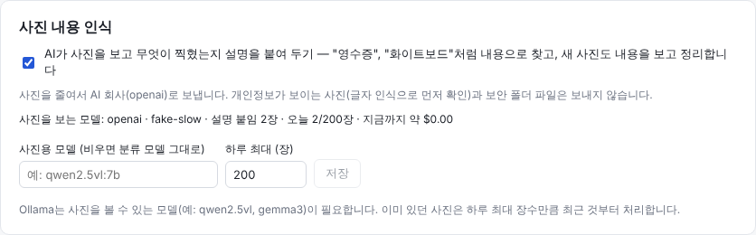
- 사진은 긴 변 1568픽셀로 줄여서 AI에 보냅니다. Anthropic·OpenAI처럼 **인터넷 AI를 쓰면 사진이 그 회사로 전송**됩니다. Ollama(이 PC 안의 AI)를 쓰면 밖으로 나가지 않습니다 — Ollama는 사진을 볼 수 있는 모델(예: `qwen2.5vl`, `gemma3`)을 **사진용 모델** 칸에 적으세요(비우면 분류 모델 그대로).
- 보내지 않는 사진: 사진 속 글자(위 글자 인식)나 파일 이름에 **개인정보가 보이는 사진**, 보안 폴더·암호화 보관 파일, 10KB 미만(아이콘)·20MB 넘는 그림. AI 설정에서 **본문 보내기**를 끄면 사진도 보내지 않습니다.
- 이미 있던 사진은 **하루 최대 장수**(기본 200장)만큼 최근 것부터 뒤에서 처리합니다. 같은 사진을 옮기거나 복사해도 다시 보내지 않습니다. 카드에 오늘 보낸 장수와 지금까지의 대략 비용이 보입니다(Claude Haiku 기준 사진 한 장에 몇 원 이하).
- 실패한 사진은 카드의 **실패한 N장 다시 시도**로 다시 보냅니다. AI가 응답하지 않으면 남은 사진은 기다렸다가 나중에 이어서 합니다(검색·정리는 그대로 동작).

- 오른쪽 **고객사** 드롭다운으로 한 고객사의 폴더 안에서만 찾을 수 있습니다(5장 "고객사 자료는 어디 있나요?").

---

## 8. 되돌리기

- **자동 이동 한꺼번에 되돌리기**: 되돌리기 탭 맨 위 카드에서 기간(최근 1시간~7일)을 고르면 그동안 규칙·AI가 자동으로 옮긴 파일 수가 나옵니다. 버튼 한 번으로 전부 원래 자리로 돌아가고, 직접 확인해서 옮긴 것은 건드리지 않습니다. 자동 정리가 엉뚱하게 돌았을 때 쓰세요.

모든 이동은 기록됩니다. **되돌리기** 탭(이동 기록)에서 묶음(배치)마다 **되돌리기**를 누르면 원래 자리로 돌아갑니다.

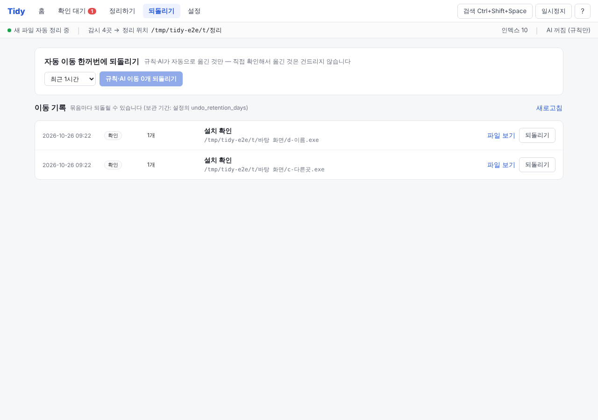

- 되돌린 파일은 다시 자동으로 옮기지 않습니다.
- 정리하다 비게 된 폴더는 지우지 않고 남겨 둡니다.
- 원래 자리에 같은 이름의 다른 파일이 생겼으면 덮어쓰지 않고 "충돌"로 알려 줍니다.
- **중복 정리(휴지통)** 묶음은 되돌릴 수 없습니다. 휴지통으로 보낸 파일은 OS 휴지통에서 직접 복원합니다(되돌리기 → **휴지통 열기**). 파일 보기에 "🗑 … → 휴지통 (남긴 사본: …)"이 나와 어느 사본이 남았는지 알 수 있습니다. 복원한 뒤 되돌리기를 다시 누르면 "복원됨"으로 표시됩니다.

명령줄: `tidy undo --last`, `tidy undo --batch <id>`, `tidy log --batches`.

---

## 9. 설정 화면 한눈에 보기

설정 탭은 왼쪽 메뉴의 6개 페이지입니다(창이 좁으면 위쪽 가로 탭). 주소가 페이지마다 달라 `#/main/settings/rules`처럼 바로 열 수 있습니다. **저장 버튼은 아래쪽 하나**로, 모든 페이지의 변경을 함께 저장합니다(저장 전에는 "저장하지 않은 변경이 있습니다").

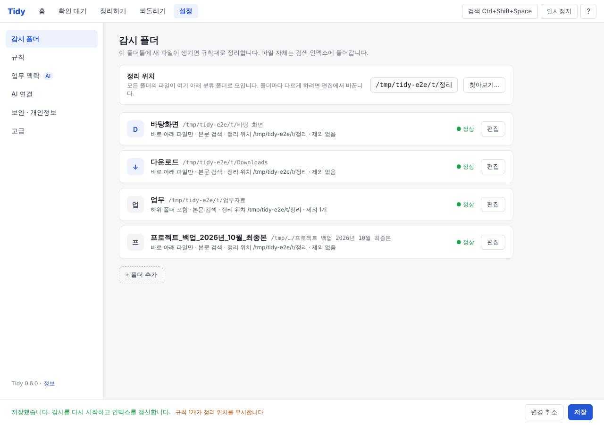

| 페이지 | 내용 |
|---|---|
| 감시 폴더 | 맨 위 **정리 위치**(공통, 찾아보기…), **옮길 자리에 똑같은 파일이 이미 있으면**(건너뜀·번호·휴지통), 폴더 카드(별칭·경로·요약·상태) → **편집**: 별칭, 하위 폴더 포함, 본문 인덱싱, 종류(로컬/네트워크 NAS), 정리 위치(공통 / 이 폴더 안에서 / 다른 폴더…), 제외 폴더, 감시 그만두기. **+ 폴더 추가** |
| 규칙 | 한 줄 규칙 목록(하나씩 펼침), AI로 규칙 만들기, + 규칙 추가, rules.toml 직접 편집 |
| 업무 맥락 | 맥락 사전, 바탕화면에서 뽑기, 폴더 틀, 미분류 기준, 감시 중 새 파일 (AI 필요) |
| AI 연결 | 제공자(Anthropic·OpenAI 호환·Ollama), 모델, API 키, 자동 이동 기준, 본문 보내기, 의미검색 모델, **사진 내용 인식**(켜기/끄기·사진용 모델·하루 최대·진행 상황) |
| 보안 · 개인정보 | 탐지 항목·건수, 보관 방식, 승인 방식, 보관 비밀번호 |
| 고급 | 사진·스캔 PDF 속 글자 검색(켜기/끄기·진행 상황), 무시한 파일, 데이터베이스 위치, 검색 단축키, 조용 모드, 자동 시작, 하루 한 번 새 버전 확인, 마법사 다시 실행 |

**정리 위치**를 한 번 정하면(예: `D:\정리`) 모든 폴더의 파일이 그 아래 분류 폴더로 모입니다. 한 폴더만 다르게 하려면 그 폴더 **편집** → 정리 위치에서 "이 폴더 안에서" 또는 "다른 폴더…"를 고릅니다.

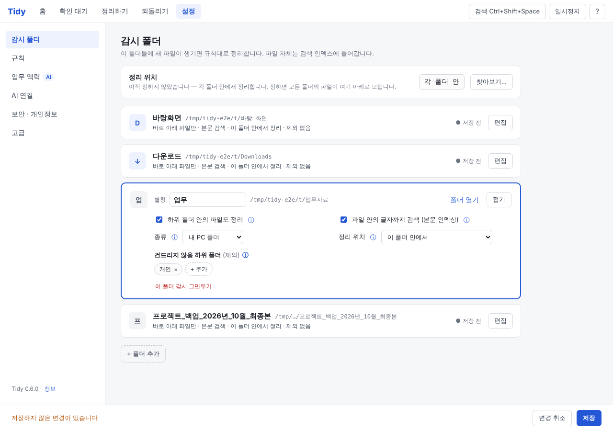

어려운 항목 옆의 **ⓘ**를 누르면 한 줄 설명이, "예시"를 펼치면 예가 나옵니다. 저장줄의 **변경 취소**는 저장하지 않은 수정을 버립니다(파일 이동을 되돌리는 것은 되돌리기 탭).

---

## 10. 도움말·정보·업데이트

오른쪽 위 **?**(도움말) 메뉴 (좁은 창에서는 **≡** 메뉴 안):

- **사용 설명서** — 이 문서를 기본 브라우저로 엽니다.
- **고객사 자료는 어디 있나요?** — 이 문서의 해당 절(고객사별 보기·검색 필터)을 엽니다.
- **문의·버그 신고** — GitHub에 새 이슈를 쓰는 화면을 엽니다. 버전·OS·설정 파일 위치가 미리 채워져 있으니 내용만 적으세요(파일 내용이나 API 키는 적지 마세요). GitHub 계정이 필요합니다.
- **업데이트 확인** — 최신 릴리스와 지금 버전을 비교합니다. 새 버전이면 Windows는 **지금 업데이트** 버튼이 나옵니다. 누르면 설치 파일을 받아 릴리스와 같은 파일인지(SHA-256) 확인하고, 설치한 뒤 Tidy가 자동으로 다시 켜집니다(설정·기록은 그대로). macOS·Linux는 "**받기**"로 설치 파일을 엽니다. 최신이면 "최신 버전입니다", 인터넷이 안 되면 "확인하지 못했습니다" — 어느 경우에도 다른 기능은 그대로 동작합니다.
- **정보** — 버전, 빌드(커밋), 저장소, 라이선스(MIT), 설정 파일·DB 위치(각각 **폴더 열기**), **로그 폴더 열기**(`%LOCALAPPDATA%\tidy\logs`; 문의할 때 `tidy.log`를 첨부하면 도움이 됩니다). 트레이 메뉴의 **정보…**로도 열립니다.

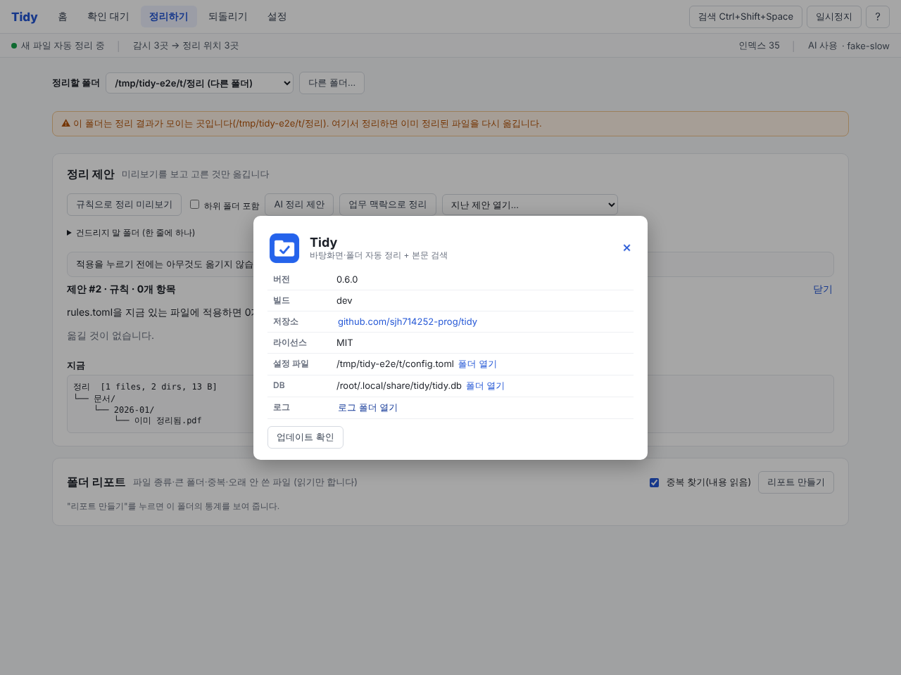

Tidy를 켤 때마다, 그리고 켜 둔 동안 하루 한 번 새 버전을 확인합니다. 있으면 상태줄 오른쪽에 **● 새 버전 0.x.y**가 나오고, 누르면 정보 창에서 바로 **지금 업데이트**를 누를 수 있습니다. 끄려면 설정 → 고급 → "새 버전 확인"을 해제합니다.

---

## 11. 문제 해결

### 설치 파일을 실행하면 "Windows의 PC 보호"가 뜹니다
**추가 정보 → 실행**을 누르세요(1장). 서명 인증서가 없는 앱이라 처음 한 번 뜹니다.

### AI 키는 어떻게 넣나요?
1. 설정 → AI 연결 → "AI 사용" 체크, 제공자(예: Anthropic) 선택
2. 모델 이름(예: `claude-haiku-5-5`)과 **API 키**를 입력하고 아래 **저장**
3. 그 바로 아래 **AI 연결 테스트**로 확인합니다. 결과가 버튼 아래에 나오고, 상태줄에 "AI 사용 (…)"이 보이면 됩니다. 의미검색 모델을 쓰면 그 섹션 아래 **의미검색 연결 테스트**가 따로 있습니다.

제공자를 바꿔도 제공자마다 모델·키 이름·주소를 따로 기억합니다. 예를 들어 Anthropic에서 Ollama로 바꿨다가 다시 Anthropic을 고르면 예전 설정이 그대로 돌아오고, 키도 다시 넣을 필요가 없습니다(목록에 "· 저장된 설정" 표시).

연결 테스트가 "크레딧(잔액)이 부족합니다"로 실패하면 Tidy 문제가 아니라 Anthropic 계정 잔액 문제입니다. console.anthropic.com → Plans & Billing에서 충전하면 바로 됩니다.

키는 OS 키체인(Windows 자격 증명 관리자의 `tidy` 항목)에만 저장되고 설정 파일에는 이름(`tidy/anthropic`)만 남습니다. 회사 PC라 파일 내용을 밖으로 보내기 싫다면 "본문 앞부분도 보내기"를 끄거나, 로컬 AI(Ollama)를 쓰세요.

AI가 연속으로 실패하면 상태줄이 "AI 사용 불가 — 규칙만"으로 바뀌고 규칙만으로 계속 동작합니다. 다시 응답하면 자동으로 돌아옵니다.

### "AI 필요"라고 나오고 버튼이 눌리지 않습니다
AI가 꺼져 있거나 연결이 안 된 상태입니다. "AI 연결에서 켜기"를 눌러 설정 → AI 연결에서 켜고 연결 테스트를 통과시키세요.

### NAS·공유 폴더 파일이 늦게 정리됩니다 / 정리가 멈췄습니다
- 설정 → 감시 폴더 → 편집에서 종류를 **네트워크(NAS)** 로 두세요. 확인 간격(기본 120초)마다 다시 살펴봅니다.
- 변경 알림을 보내지 않는 NAS는 "주기 확인만 사용"을 켭니다.
- 연결이 끊기면 그 폴더만 일시정지하고 60초마다 다시 확인합니다. 다시 연결되면 끊긴 동안 생긴 파일도 처리합니다.
- 옮기는 도중 끊겨도 파일은 원래 자리나 목적지 중 한 곳에 온전히 남습니다(다음 시작 때 자동 정리, 또는 `tidy recover`).
- 데이터베이스(설정 → 고급)는 NAS에 두지 마세요. 로컬 디스크만 됩니다.

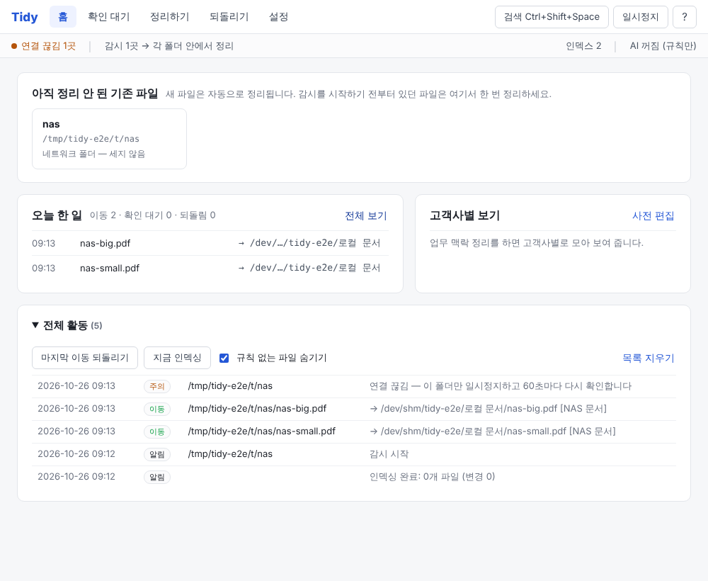

### 정리하고 싶지 않은 파일이 옮겨졌습니다
되돌리기 탭에서 되돌리고(8장), 확인 팝업이 뜰 때 **무시**를 누르거나 규칙의 순서·조건을 고치세요. 정리하기 탭의 "건드리지 말 폴더"에 적은 폴더는 그 정리 제안·업무 맥락 정리에서 제외되고, 늘 빼고 싶은 폴더는 설정 → 감시 폴더 → 편집의 **제외 폴더**에 넣습니다.

### 정리한 파일이 엉뚱한 곳(문서 폴더 등)으로 갔습니다
"지정 위치로 모으기"를 쓰는데 규칙 목적지가 절대 경로이면 정리 위치를 무시합니다. 규칙 카드의 "정리 위치 무시" 경고에서 **상대 경로로 바꾸기**를 누르세요(4장). 이미 옮겨진 파일은 되돌리기 탭에서 되돌릴 수 있습니다.

### 문의하고 싶습니다
**?** → **문의·버그 신고**. 정보 창의 **로그 폴더 열기**에서 `tidy.log`를 함께 올려 주면 원인을 찾기 쉽습니다.

### 압축 파일(zip)이 탐색기에서 열리지 않습니다
AES 암호화 zip은 Windows 탐색기 기본 기능이 지원하지 않습니다. 반디집·7-Zip·알집을 쓰거나 Tidy 검색에서 여세요(6장).

---

## 12. NAS에서 직접 정리하기 (시놀로지·QNAP)

NAS에 Tidy를 설치해 두면 **PC가 꺼져 있어도 NAS가 직접** 새 파일을 규칙대로 정리하고, 파일 안의 글자(사진 속 글자 포함)까지 검색할 수 있게 해 둡니다. NAS 안에서 옮기므로 네트워크로 복사하지 않아 빠릅니다. 확인 대기·되돌리기·검색은 이 PC의 Tidy에서 함께 봅니다. Docker(시놀로지 **Container Manager**, QNAP **Container Station**)가 되는 NAS면 됩니다.

### 12.1 설치 (한 번만)
1. 설정 → **NAS** → **설치 파일 만들기**: 이름(예: 사무실), 정리할 공유 폴더 이름(예: `업무, 자료`), 볼륨(시놀로지는 보통 `/volume1`)을 넣고 누릅니다. 연결 암호가 새로 만들어져 이 PC의 키체인에 들어가고, 그 암호가 든 `docker-compose.yml` 내용이 나옵니다(다운로드 폴더에도 저장). **내용 복사**를 누릅니다.
2. 시놀로지: 패키지 센터에서 **Container Manager** 설치 → File Station에서 `docker` 공유 폴더 안에 `tidy` 폴더 만들기 → Container Manager › **프로젝트** › **생성** → 프로젝트 이름 `tidy`, 경로 `docker/tidy`, 원본 "docker-compose.yml 만들기"에 붙여넣기 → 다음 → 완료. 이미지를 내려받고 바로 시작합니다.
   - QNAP: Container Station › 애플리케이션 › 생성에 붙여넣습니다.
   - 인터넷이 안 되는 NAS: 릴리스 페이지의 `tidy-agent_<버전>_amd64.tar.gz`(ARM NAS는 `arm64`)를 받아 Container Manager › 이미지 › 추가 › 파일에서 추가로 올린 뒤 같은 순서로 프로젝트를 만듭니다(이미지 이름은 `ghcr.io/sjh714252-prog/tidy-agent:latest`로 둡니다).
3. 다시 Tidy에서 **NAS 주소**(예: `192.168.0.10`)를 넣고 **연결 확인**. "연결됨"이 나오면 끝입니다. 포트는 7841을 씁니다.
   - 설치 파일을 다른 PC에서 만들었다면 "설치 파일을 다른 PC에서 만들었거나 직접 설치했다면"을 펼쳐 연결 암호(`TIDY_TOKEN` 값)를 넣으세요.

### 12.2 NAS가 정리할 폴더와 규칙
연결되면 같은 화면에 NAS 패널이 나옵니다.

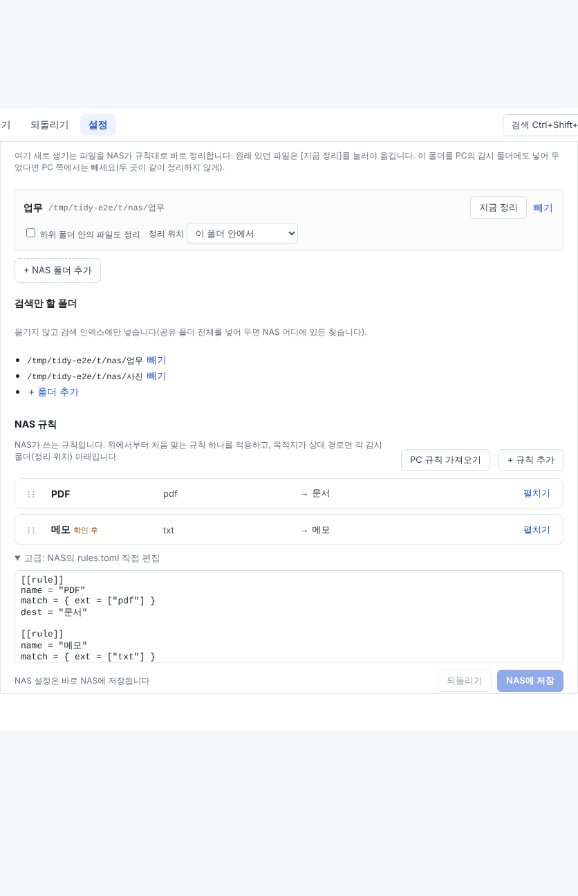

- **+ NAS 폴더 추가**: NAS의 폴더 트리에서 감시할 폴더를 고릅니다. 고른 폴더가 든 공유 폴더 전체는 **검색만 할 폴더**에 저절로 들어가 NAS 어디에 있든 찾을 수 있습니다.
- **NAS 규칙**: PC의 규칙 카드와 똑같이 편집합니다. **PC 규칙 가져오기**로 이 PC 규칙을 그대로 쓸 수도 있습니다.
- **NAS에 저장**을 눌러야 NAS에 적용됩니다(설정 화면 아래 저장 버튼과 따로).
- 원래 있던 파일은 건드리지 않습니다. 정리하려면 폴더 옆 **지금 정리** → 개수와 예시를 확인하고 승인하면 NAS가 한 묶음으로 옮깁니다.
- NAS에는 AI 키를 두지 않으므로 NAS는 규칙으로만 정리합니다. 규칙에 안 맞는 파일은 그대로 둡니다("옮기기 전에 묻기" 규칙은 확인 대기로).
- 이 PC의 감시 폴더에 같은 NAS 공유 폴더가 있다면 PC 쪽에서는 빼세요(두 곳이 같이 정리하지 않게).
- **PC에서 보는 경로**: 검색 결과를 이 PC에서 열 때 쓰는 경로입니다(예: NAS의 `/data/업무` = PC의 `\\192.168.0.10\업무`). 연결할 때 저절로 채워지고, 다르면 고칩니다.

### 12.3 평소에
- **홈**의 NAS 카드에 연결 상태·오늘 정리한 수·확인 대기 수가 나옵니다.

  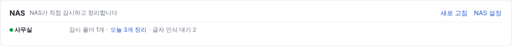
- **확인 대기** 탭 아래 **NAS 확인 대기**에서 이동·건너뜀·무시를 누르면 NAS가 직접 옮깁니다.

  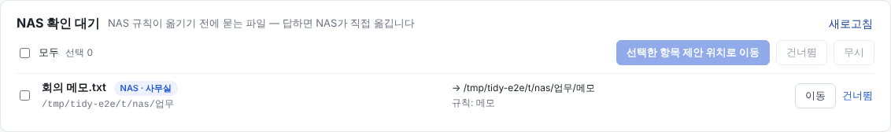
- **검색 창**: 이 PC 결과 뒤에 NAS 결과가 "NAS · 이름" 표시와 함께 이어집니다. NAS가 꺼져 있으면 아래줄에 "NAS 응답 없음"만 나오고 PC 검색은 그대로 됩니다.

  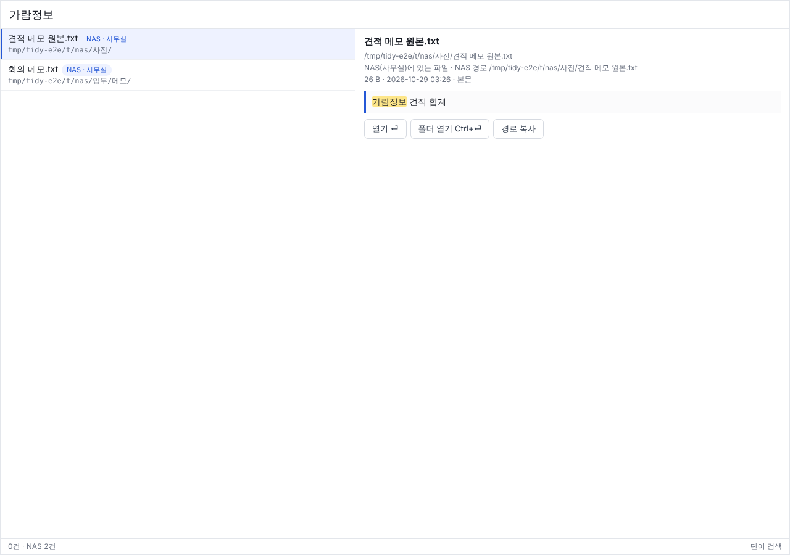
- **되돌리기** 탭 아래 **NAS에서 한 일**에서 묶음마다 되돌립니다.

  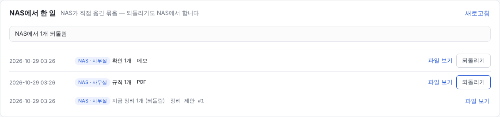

### 12.4 알아 두기
- 연결 암호는 이 PC의 키체인(Windows 자격 증명 관리자)에만 있고 설정 파일에는 없습니다. `docker-compose.yml`은 다른 사람에게 보이지 마세요. 암호를 바꾸려면 설치 파일을 다시 만들어 NAS 프로젝트에 다시 붙여넣습니다.
- 같은 사무실 망(LAN) 안에서 쓰는 것을 전제로 합니다. 밖에서 쓰려면 NAS의 역방향 프록시로 `https://` 주소를 만들어 그 주소로 연결하세요.
- NAS가 새로 만든 폴더의 소유자가 `root`로 보이면 compose 파일의 `# user: "1026:100"` 줄 주석을 풀고 NAS 사용자 번호를 넣습니다(시놀로지 SSH에서 `id 사용자이름`).
- 명령줄: NAS 안에서는 `tidy serve`, PC에서는 `tidy nas status` / `tidy nas search 견적` / `tidy nas pending` / `tidy nas log`.

